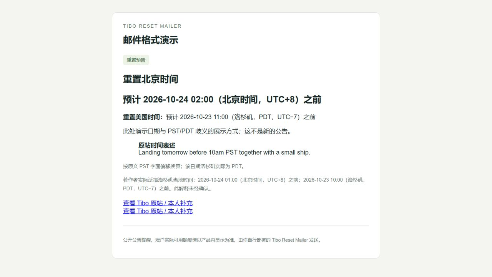

# Tibo Reset Mailer

**Tibo 发 Codex 重置公告，你收一封看得懂时间的中文邮件。**

每小时读取 [@thsottiaux 的 X 官方公开页面](https://x.com/thsottiaux)，筛选明确的 Codex 额度重置消息，邮件先列北京时间，再列美国洛杉矶时间，保留原始表述与原帖链接。同一版本只提醒一次。

**v0.2.0-beta · Codex 辅助配置 / 独立运行 · Python 3.11+ · MIT**

[English](docs/README.en.md) · [邮件示例](docs/email-preview.html) · [故障排查](docs/troubleshooting.md) · [设计与边界](docs/design.md)

> GitHub 提供源码和下载。提醒程序运行在你自己的电脑或服务器上；本地关机或断网时无法检查。仓库不是公共邮箱订阅服务。

## 最省手工操作：把这段话发给自己的 Codex

将下面的收件邮箱替换成自己的地址，整段复制给支持本地执行的 Codex：

```text
请帮我部署这个个人提醒项目：https://github.com/lovely-car/tibo-reset-mailer
先阅读仓库 AGENTS.md 和 CODEX_SETUP.md，替我完成环境检查、安装、来源验证和每小时提醒配置。
我的收件邮箱是：在这里填自己的邮箱。
优先使用你已连接的邮箱发送，由你判断公告；需要连接邮箱时告诉我具体操作。
我授权向上述邮箱发送一次首次汇总，并在发现新的明确 Codex 重置公告时自动发邮件，无需逐次询问。
邮件同时显示北京时间、美国洛杉矶时间、中文摘要和原帖链接；没有新公告时保持安静。
已有相同提醒时优先复用，避免重复安装和重复发信。完成后核验邮件回执与定时任务，并说明运行要求。
```

用户主要需要提供**收件邮箱**，在提示时连接自己的发信邮箱。安装、验证和定时配置交给 Codex。具备可用邮箱连接时无需手工填 SMTP，也不用额外配置模型 API Key。

这条路线需要当前 Codex 环境提供本地执行、可发信的连接和可用定时任务；**不是任意 Codex 环境都天然支持这些能力**。Codex 会先检查，缺少时明确说明未完成的部分。本地定时任务仍需要电脑开机联网、宿主保持运行，见 [官方说明](https://learn.chatgpt.com/docs/automations?surface=app)。无需购买服务器来配置个人提醒。

开发者入口：[CODEX_SETUP.md](CODEX_SETUP.md)；每轮执行：[CODEX_MONITOR.md](docs/CODEX_MONITOR.md)。下面保留原来的手工 SMTP 安装方式。

## 邮件会是什么样



```text
重置北京时间：预计 2026-10-24 02:00（UTC+8）之前
重置美国时间：预计 2026-10-23 11:00（洛杉矶，PDT，UTC−7）之前
原帖时间表述：Landing tomorrow before 10am PST together with a small ship.

按原文 PST 字面偏移换算。若作者实际泛指当地 10:00 PDT，
则北京时间为 10 月 24 日 01:00 前；这一解释未经确认。

来源：X 原帖与 Tibo 本人补充链接
```

这是历史公告的**格式演示**，不是当前重置通知。`before` 表示截止时间，不能理解为准点重置。原帖未公布有效时刻时，两行会显示“具体重置时刻未公布”。

## 五步启动

先下载并解压仓库源码，在项目目录打开终端。也可以使用 `git clone` 下载。

**1. 安装**

```bash
python -m venv .venv
# Windows PowerShell:
.\.venv\Scripts\Activate.ps1
# macOS / Linux:
# source .venv/bin/activate
python -m pip install -e .
```

**2. 填自己的邮箱配置**

```bash
python -m tibo_mailer setup
```

根据提示输入收件邮箱、发信邮箱、SMTP 主机和邮箱服务商提供的授权码 / 应用密码。默认使用 465 端口的 TLS 连接。需要 587 端口时，在生成的 `.env` 中改成 `SMTP_PORT=587`、`SMTP_SECURITY=starttls`。收件邮箱可以和发信邮箱不同。

也可以复制 `.env.example` 为 `.env` 后手动填写。不要把 `.env`、数据目录或投递记录上传 GitHub。

**3. 检查配置与来源**

```bash
python -m tibo_mailer doctor
python -m tibo_mailer check --dry-run
```

`doctor` 只检查配置格式。`--dry-run` 会实时读取 X、生成邮件内容，不发送邮件、不标记帖子已读。它仍会在私有数据目录记录诊断。

**4. 主动发一封测试邮件**

```bash
python -m tibo_mailer test-email
```

这一步会真实发出一封带 `[演示]` 的邮件。确认收件箱或垃圾邮件文件夹中收到后再启动监测。

**5. 每小时自动运行**

```bash
python -m tibo_mailer run
```

保持程序和电脑运行。默认间隔 3600 秒，在 `.env` 中修改 `CHECK_INTERVAL_SECONDS` 可调整，最短支持 300 秒。首次有效扫描会发送一次汇总，历史帖子合并处理；汇总发送成功后才完成初始化。之后只提醒新消息或正文修改后的新版本。

如需由操作系统任务计划程序调用，使用 `python -m tibo_mailer check`，并使用同一个工作目录、配置文件和数据目录。禁止多个实例共享同一个目录同时运行，程序也会主动拒绝重叠执行。

## 两种判断方式

| 模式 | 配置 | 行为 |
|---|---|---|
| 默认 `rules` | `ANALYSIS_MODE=rules` | 无需模型接口。只接受明确表述，保守匹配，可能漏掉复杂隐喻或长回复链 |
| 可选 `llm` | 填写以下配置 | 由模型整理中文摘要并判断语义，再核验原文证据；需要独立的模型 API 凭据，费用按服务商规则计算 |

```dotenv
ANALYSIS_MODE=llm
LLM_BASE_URL=https://api.openai.com/v1
LLM_MODEL=填写你的可用模型名称
LLM_API_KEY=填写你自己的API密钥
```

使用支持 `POST /chat/completions` 与 JSON 输出的 OpenAI 兼容服务。没有默认模型，不会自动选择套餐或购买额度。只有相关的公开帖子会发给模型，邮箱与 SMTP 配置不会进入模型请求。服务未返回有效证据时会保留帖子等待下次重试。

接口实现参考 [OpenAI Chat Completions 文档](https://developers.openai.com/api/reference/resources/chat/subresources/completions/methods/create)。不同兼容服务的支持程度需要自行验证。

## 在服务器上长期运行

有 Docker Compose 时，先复制并填写 `.env`：

```bash
docker compose up -d --build
docker compose logs --tail 50 mailer
docker compose exec mailer python -m tibo_mailer status
```

状态存储在命名卷 `mailer-data`，容器重启后保留。不要删除这个卷，否则会丢失初始化、去重与待发记录。Docker 配置已提供；实际构建验证范围见版本发布说明。

### GitHub Actions 的作用

本仓库提供自动测试和手动 `Check public X source (no email)` 工作流，用于验证 GitHub 运行器能否读取 X。**没有提供无状态的云端定时发信任务**：临时运行器丢失投递状态会造成重复邮件。

第一版长期监测请使用本地程序或带持久卷的服务器。GitHub 云端来源检查通过，也不代表所有地区或后续每次请求都能访问 X。Actions 定时任务可能延迟，公开仓库长期没有活动也可能被自动停用，参见 [GitHub 官方说明](https://docs.github.com/en/actions/reference/workflows-and-actions/events-that-trigger-workflows#schedule)。

## 来源与时间规则

- 只接受 `@thsottiaux` 本人的原帖和可核验的本人同帖补充，忽略普通转帖、引用内其他作者的正文。
- 只提醒明确涉及 Codex 额度并带日期、相对时间、周期或已完成确认的消息。模糊的 `soon`、猜测、其他产品、API 限流和付费 credits 不提醒。
- 公开匿名页面只能展示部分历史，首次汇总明确报告可核验范围，不声称完整七天统计；预告不计为已完成事件。
- `PST` 按 UTC−8、`PDT` 按 UTC−7，`PT` 按事件当日洛杉矶的 IANA 时区换算。PST/PDT 与当日当地时区冲突时同时说明两种解释。
- `tomorrow` 以原帖可核验的发布时间和明确时区为基准，不随检查日期顺延。未知日期或时区时保留原文，不猜测。
- 来源读取失败不会被记成“没有公告”，也不会推进帖子去重状态。正文截断或相关原帖读取失败的证据延后重试。

## 投递状态

```bash
python -m tibo_mailer status
```

数据保存在 `.tibo-mailer/state.sqlite3`（可通过 `TIBO_DATA_DIR` 更改），包含去重信息、邮件内容、SMTP 接受回执状态及稳定的 `Message-ID`。**此目录是私有运行数据**，不属于开源源码。

- `pending`：明确未完成，后续检查优先重试。
- `sent`：SMTP 服务端接受邮件；最终是否进入收件箱仍由邮件系统决定。
- `unknown`：发送阶段断线或进程退出，可能已经发出。程序停止自动重发这封邮件。

遇到 `unknown`，先按 `status` 显示的 `Message-ID`、主题和原帖在发信账号中核对，再执行：

```bash
python -m tibo_mailer resolve DELIVERY_ID --sent
# 确认没有发出后，才执行：
python -m tibo_mailer resolve DELIVERY_ID --retry
```

重试会使用原 `Message-ID`，但邮件系统不保证据此去重，因此不能在结果未知时盲目重发。

## 开发与验证

```bash
python -m unittest discover -s tests -v
python -m tibo_mailer preview --output docs/email-preview.html
```

自动测试覆盖作者核验、引用隔离、时间转换、夏令时边界、消息合并、初始化、版本去重、失败重试和发信歧义。真实邮件登录、特定模型及地区网络条件，需要使用者用自己的配置验证。

这是社区项目，与 OpenAI、X、Tibo 没有官方关联。公开公告不保证你的个人账户额度已到账。X 页面结构或访问条件可能变化，详见 [故障排查](docs/troubleshooting.md)。

设计灵感来自 [Tibo Reset Reminder Skill](https://github.com/orange90/tibo_reset_reminder_skill)。本仓库的运行时与状态存储独立实现，不导入该技能，不包含其源码。独立 SMTP 路线不依赖 Codex、公共 Feed 或 Gmail 连接器；Codex 辅助路线复用宿主的判断、邮箱连接和定时能力。

## 许可证

[MIT](LICENSE)。欢迎通过 Issue 报告问题；请删除邮箱、授权码、密钥和私有数据后再提交日志。
